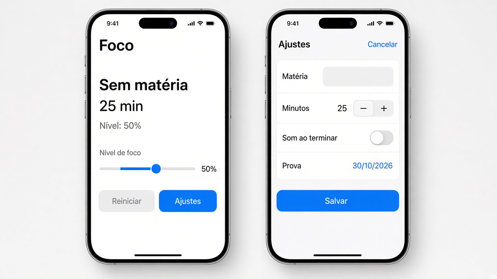
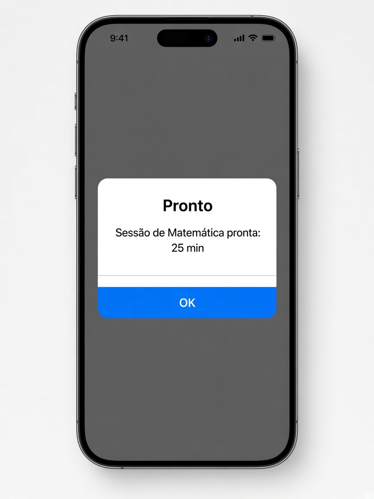

# Capítulo 5 — O que fazer

**Desenvolvimento iOS · 3º ano**

São três exercícios sobre estado e controles. Faça o seu primeiro, nos arquivos da pasta do exercício. A resolução pronta está em `Resolucoes`, na pasta do projeto, fora do app.

Em cada exercício, a parte **Componentes** diz o que usar em cada tela. Para tirar os espaços das pontas de um texto, use `trimmingCharacters(in: .whitespaces)`.

---

## 1. Ficha de foco

Pasta: `1 - Ficha de foco`

Exemplo de layout. A ordem pode mudar um pouco, desde que tudo o que o exercício pede apareça.

No começo a matéria está vazia: o slider fica desabilitado, **Reiniciar** fica cinza e **Salvar** também. A foto mostra onde cada controle fica.

Ao salvar, a sheet fecha e o alerta aparece na tela de baixo.

Monte a ficha de uma sessão de estudo. Não use `Timer`. Quem muda os valores é a pessoa, pelos controles da tela.

### A classe `FocoViewModel`

Ela guarda os dados e avisa a tela quando algo muda.

- matéria, começando vazia
- minutos, começando em 25
- nível de foco, começando em 0,5
- som, começando desligado
- data da prova, começando em hoje

`formularioValido` só é verdadeiro quando a matéria, sem espaços nas pontas, não está vazia e o nível é maior que 0.

`reiniciar()` volta matéria para vazio, minutos para 25, nível para 0,5, som para desligado e a data para hoje.

Use classe, não struct. As telas precisam olhar para o mesmo objeto.

**Componentes**

- `class FocoViewModel: ObservableObject`.
- Cada dado é `@Published`. Quando muda, a tela redesenha.
- `formularioValido` é uma variável calculada. Não guarde isso em outro `@Published`.
- `reiniciar()` apenas devolve os cinco valores ao começo.

### A tela principal `FocoView`

Ela cria a classe.

- mostra a matéria, ou o texto “Sem matéria” quando o campo está vazio
- mostra os minutos
- mostra o nível em porcentagem: `Int(nivelFoco * 100)`
- botão **Reiniciar**, que chama `reiniciar()`. Fica desabilitado se a ficha já está no começo: matéria vazia, 25 minutos, nível 0,5 e som desligado
- botão **Ajustes**, que abre uma sheet. O Bool da sheet fica só nesta tela, porque só ela precisa saber se o painel está aberto

O slider do nível não fica aqui. Ele fica na view filha.

O alerta também fica nesta tela, não dentro da sheet. A sheet só liga o Bool do alerta e fecha. Se o alerta morar na sheet, ele some junto com ela.

**Componentes**

- `@StateObject` cria a classe uma vez.
- Dois `@State` Bool: um da sheet, outro do alerta.
- `VStack` com `Text` da matéria, dos minutos e da porcentagem.
- `PainelFocoView(foco: foco)`. Passe o objeto. Não crie outra classe aqui dentro.
- `Button("Reiniciar")` com `.disabled` quando a ficha já está no começo.
- `Button("Ajustes")` liga o Bool da sheet.
- `.sheet(isPresented:)` abre `AjustesFocoView`. Entregue a classe e o `Binding` do alerta, com `$`.
- `.alert("Pronto", isPresented:)` com a mensagem “Sessão de (matéria) pronta: (minutos) min.” e um `Button("OK")`.
- `.navigationTitle("Foco")`.

### A view filha `PainelFocoView`

Recebe a classe que a tela principal já criou. Não cria outra.

- um slider de 0 a 1, ligado ao nível de foco
- o slider fica desabilitado enquanto a matéria, sem espaços nas pontas, estiver vazia
- um texto com a porcentagem

**Componentes**

- `@ObservedObject var foco: FocoViewModel`.
- `Slider(value: $foco.nivelFoco, in: 0...1)`.
- `.disabled` no slider enquanto a matéria, sem espaços, estiver vazia.
- `Text` com `Int(foco.nivelFoco * 100)`.

### A sheet `AjustesFocoView`

Um `Form` com:

- campo da matéria, com autocapitalização de palavras
- stepper dos minutos, entre 5 e 60
- toggle “Som ao terminar”
- seletor “Prova”, só a data

Botão **Salvar**:

- desabilitado quando `formularioValido` for falso
- ao tocar, fecha a sheet e mostra um alerta: “Sessão de (matéria) pronta: (minutos) min.”

**Componentes**

- `@ObservedObject` da mesma classe.
- `@Binding var mostrarAlerta: Bool`, para a tela de baixo abrir o alerta.
- `Form`.
- `TextField("Matéria", text: $foco.materia)` com `.textInputAutocapitalization(.words)`.
- `Stepper` de 5 a 60, ligado em `$foco.minutosAlvo`.
- `Toggle("Som ao terminar", isOn: $foco.somLigado)`.
- `DatePicker("Prova", selection: $foco.dataProva, displayedComponents: .date)`.
- `Button("Salvar")` com `.disabled(!foco.formularioValido)`.
- No toque: ligue `mostrarAlerta` e chame `dismiss()`.

---
