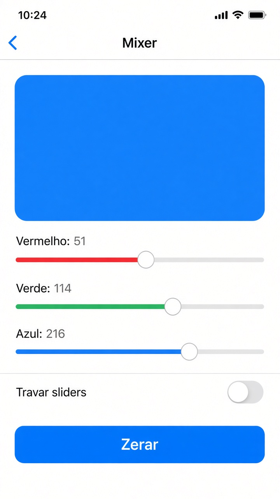

# Capítulo 5 — O que fazer

**Desenvolvimento iOS · 3º ano**

São três exercícios sobre estado e controles. Faça o seu primeiro, nos arquivos da pasta do exercício. A resolução pronta está em `Resolucoes`, na pasta do projeto, fora do app.

Em cada exercício, a parte **Componentes** diz o que usar em cada tela. Para tirar os espaços das pontas de um texto, use `trimmingCharacters(in: .whitespaces)`.

---

## 2. Mixer de cor

Pasta: `2 - Mixer de cor`

Exemplo de layout. Os sliders vão de 0 a 1. A foto mostra a ordem dos controles.

Uma tela com um retângulo colorido e três sliders: vermelho, verde e azul. Cada um vai de 0 a 1.

Os três números ficam na tela principal, com `@State`. Os sliders ficam numa view filha. A filha recebe `@Binding`. Na chamada, use `$`. Sem o `$`, a filha ganha uma cópia e o retângulo não muda.

- um toggle “Travar sliders” desliga os três de uma vez
- um botão **Zerar** coloca as três cores em 0
- com os sliders travados, **Zerar** também fica desabilitado

Não precisa de view model. São só três números desta tela.

**Componentes da tela `MixerCorView`**

- Quatro `@State`: `vermelho`, `verde`, `azul` (números de 0 a 1) e `travado` (Bool, começa falso).
- `RoundedRectangle` preenchido com `Color(red: verde: blue:)`, usando os três números.
- A filha é chamada assim: `ControleCorView(vermelho: $vermelho, verde: $verde, azul: $azul, travado: travado)`. O `$` é o que liga o slider ao número daqui.
- `Toggle("Travar sliders", isOn: $travado)`.
- `Button("Zerar")` coloca os três números em 0 e tem `.disabled(travado)`.
- `.navigationTitle("Mixer")`.

**Componentes da filha `ControleCorView`**

- Três `@Binding var` para as cores. Um `let travado: Bool` chega só para ler.
- Três `Slider(value:in:)`, de 0 a 1. No `Slider`, o `value` já é o `Binding`. Não coloque outro `$` na frente.
- `.disabled(travado)` em cada slider.
- Um `Text` ao lado de cada um, com o nome da cor.

---
