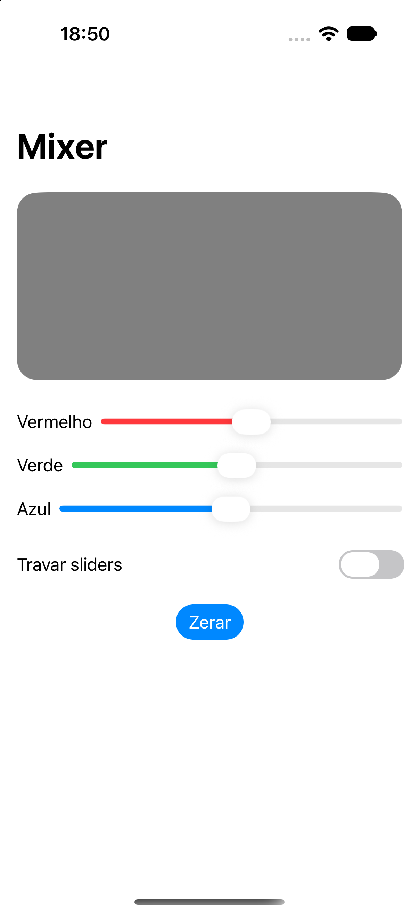

> **EN:** SwiftUI practice project: Mixer de cor. Open `MixerCor.xcodeproj` in Xcode and run on an iOS simulator.
>
> O restante deste documento está em português brasileiro.

# Mixer de cor

Atividade de Desenvolvimento iOS — Capítulo 5, exercício 2.

Mistura RGB com três `@State`, controles filhos com `@Binding`, trava conjunta e botão de zerar.

## Executar

1. Abra `MixerCor.xcodeproj` no Xcode.
2. Selecione o scheme `MixerCor` e um simulador de iPhone.
3. Execute com **⌘R**.

Requer iOS 17 ou superior e Xcode com o SDK correspondente. Não há dependências externas. Para um iPhone físico, selecione seu time de assinatura no Xcode.

## Organização e estudo

O código está em [`MixerCor/`](./MixerCor/). O [enunciado](./ENUNCIADO.md) e as imagens de referência do professor estão incluídos para comparação.

Os dados ficam em memória durante a execução, conforme o escopo do exercício. Fechar e reabrir o app restaura os exemplos.

[Repositório geral com todas as atividades](https://github.com/trvzera/atividades-ios).

## Tela

## Validação

Projeto compilado individualmente para o simulador no Xcode 27.2. [Resultados e cobertura](https://github.com/trvzera/atividades-ios/blob/main/VALIDACAO.md).
