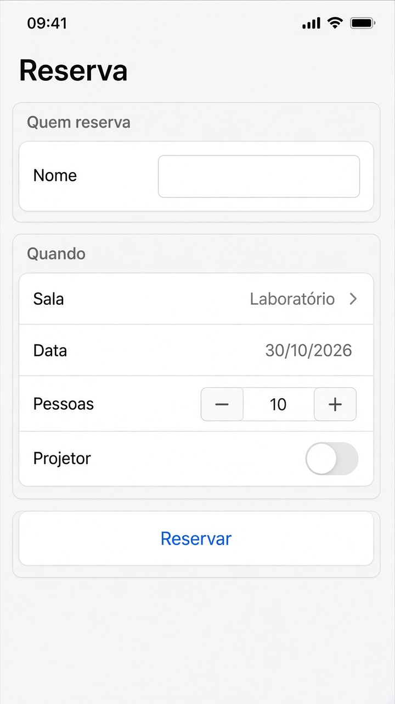
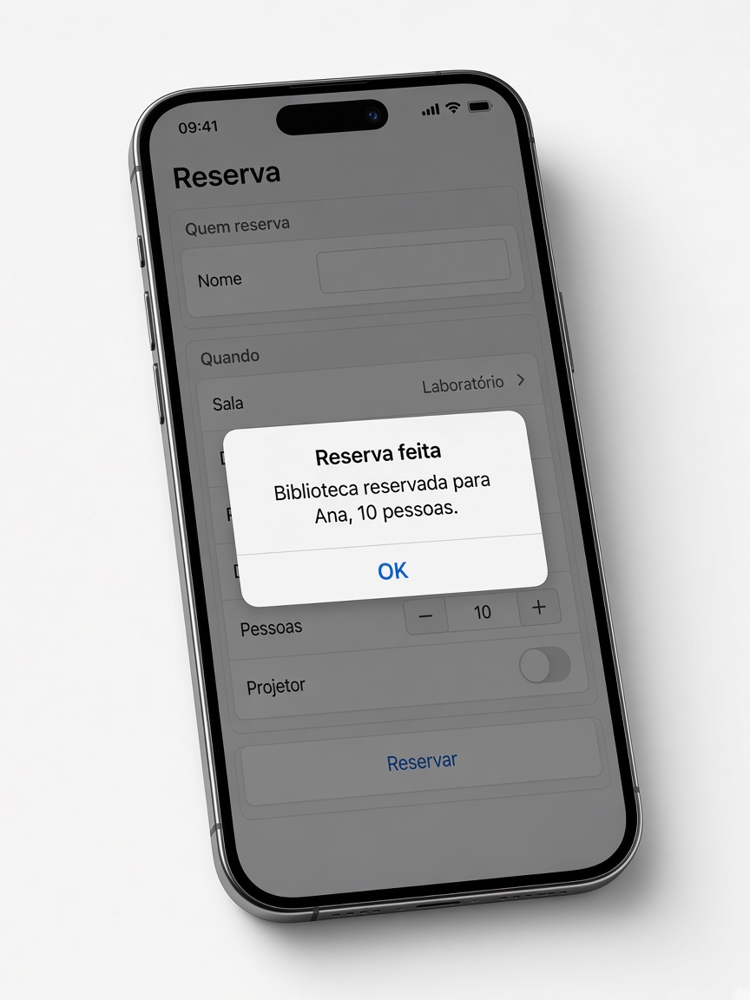

# Capítulo 5 — O que fazer

**Desenvolvimento iOS · 3º ano**

São três exercícios sobre estado e controles. Faça o seu primeiro, nos arquivos da pasta do exercício. A resolução pronta está em `Resolucoes`, na pasta do projeto, fora do app.

Em cada exercício, a parte **Componentes** diz o que usar em cada tela. Para tirar os espaços das pontas de um texto, use `trimmingCharacters(in: .whitespaces)`.

---

## 3. Reserva da sala

Pasta: `3 - Reserva da sala`

Exemplo de layout.

O alerta abre por cima dessa tela.

Um formulário de reserva. Tudo com `@State` nesta tela. Nenhuma outra view usa esses dados, então não crie classe.

Campos:

- nome
- sala, num `Picker`: Laboratório, Biblioteca e Auditório
- data, só o dia
- pessoas, num stepper de 1 a 40
- projetor, num toggle

O botão **Reservar** fica desabilitado se o nome, sem espaços nas pontas, estiver vazio.

Quando a reserva acontece, abre um alerta dizendo qual sala foi reservada, para quem, e quantas pessoas.

**Componentes**

- `Picker("Sala", selection: $sala)` com três linhas escritas na mão: `Text("Laboratório").tag("Laboratório")`, e o mesmo para Biblioteca e Auditório. A sala é um `String`. Começa em `"Laboratório"`.
- `Form` com duas `Section`: **Quem reserva** e **Quando**.
- `TextField("Nome", text:)` com `.textInputAutocapitalization(.words)`.
- Seis `@State` nesta view: nome, sala, data, pessoas, projetor e o Bool do alerta. Pessoas começa em 10. A sala é o texto `"Laboratório"`.
- `DatePicker("Data", selection:, displayedComponents: .date)`.
- `Stepper` de 1 a 40. O texto mostra o número.
- `Toggle("Projetor", isOn:)`.
- `Button("Reservar")` com `.disabled` enquanto o nome, sem espaços, estiver vazio. O toque só liga o Bool do alerta.
- `.alert("Reserva feita", isPresented:)` com `Button("OK")`. A mensagem monta a sala, o nome e a quantidade: “Biblioteca reservada para Ana, 10 pessoas.”
- `.navigationTitle("Reserva")`.
