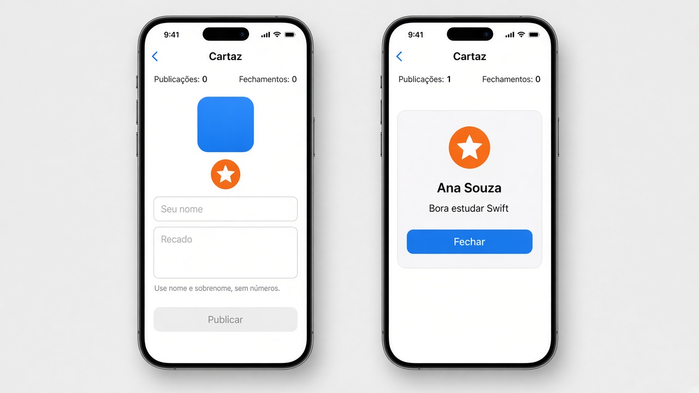

# Capítulo 6 — O que fazer

**Desenvolvimento iOS · 3º ano**

São três exercícios sobre o que a tela faz quando a pessoa toca, arrasta ou digita. Faça o seu primeiro, nos arquivos da pasta do exercício. A resolução pronta está em `Resolucoes`, na pasta do projeto, fora do app.

Tudo que muda na tela passa por `@State`.

Em cada exercício, a parte **Componentes** diz o que usar. No `onChange` do iOS 17, use as duas variáveis: `.onChange(of: nome) { _, novo in }`. O `novo` é o valor depois da mudança.

Para tirar os espaços das pontas de um texto, use `trimmingCharacters(in: .whitespaces)`.

---

## 1. Cartaz da turma

Pasta: `1 - Cartaz da turma`

Exemplo de layout. Os contadores ficam visíveis nos dois momentos.

Uma tela só, o cartaz, com três áreas.

### Selo

Um quadrado de 120 por 120.

- um toque troca a cor para uma cor aleatória, dentro de `withAnimation`
- uma pressão longa alterna a escala entre 1 e 1,3, também com `withAnimation`
- a cor e a escala são estado desta peça, não da tela inteira

**Componentes de `SeloView`**

- `@State` da cor, começando em azul, e `@State` da escala, começando em 1.
- `RoundedRectangle` com `.fill`, `.frame(width: 120, height: 120)` e `.scaleEffect`.
- `.onTapGesture` chama `withAnimation` e troca a cor por `Color(red:green:blue:)` com `.random(in: 0...1)`.
- `.onLongPressGesture` chama `withAnimation` e alterna a escala: se está em 1, vai para 1,3; se está em 1,3, volta para 1.

### Figurinha

Um círculo de 100 por 100, com um SF Symbol dentro.

- arrastar move o círculo
- ao soltar, ele volta para a origem com `withAnimation`
- a pinça muda a escala. O mínimo é 0,5 e o máximo é 2,5
- o giro muda o ângulo

Se dois gestos no mesmo elemento não funcionarem juntos, use `simultaneousGesture` na pinça e no giro. O arraste pode ficar no gesto principal.

**Componentes de `FigurinhaView`**

- Três `@State`: posição (`CGSize.zero`), escala (1) e ângulo (`Angle.zero`).
- `Circle` de 100 por 100, com `.overlay` de `Image(systemName: "star.fill")`.
- `.scaleEffect`, `.rotationEffect` e `.offset` ligam os três estados.
- `.gesture(DragGesture())`. No `onChanged`, a posição recebe `valor.translation`. No `onEnded`, `withAnimation` devolve a posição para `.zero`.
- `.simultaneousGesture(MagnificationGesture())`. A escala fica entre 0,5 e 2,5: `min(max(valor, 0.5), 2.5)`.
- `.simultaneousGesture(RotationGesture())`. O ângulo recebe o `valor`.

### Recado

Um campo “Seu nome” e um campo “Recado”. A mensagem de cada um muda com `onChange`, a cada letra.

- nome válido: pelo menos duas palavras e nenhum número. Se não for, a mensagem é “Use nome e sobrenome, sem números.”
- recado válido: entre 5 e 80 caracteres. Abaixo de 5, “Recado curto demais.” Acima de 80, “Recado longo demais.”
- borda verde no campo válido, vermelha no inválido
- campo vazio fica sem mensagem e com borda cinza
- um texto mostra a mensagem do campo que está errado. Se os dois estiverem certos, mostre “Pronto para publicar.”

O botão **Publicar** fica desabilitado enquanto nome ou recado forem inválidos. Ao tocar, esconde o formulário e mostra um cartão com o nome, o recado e a figurinha.

No cartão publicado:

- `onAppear` soma 1 em publicações
- `onDisappear` soma 1 em fechamentos

Um botão **Fechar** volta ao formulário. Os dois contadores ficam visíveis o tempo todo, fora do `if`.

**Componentes de `CartazView`**

- `@State` do nome, do recado, das duas mensagens, de um Bool “publicado” e dos dois contadores.
- Os contadores são `Text` fora do `if`, para continuarem na tela quando o cartão aparece.
- `if publicado` mostra o cartão. No `else`, o formulário.
- Dois `TextField`. Cada um tem `.onChange(of:) { _, novo in }` para recalcular a mensagem.
- A borda é um `.overlay` com `RoundedRectangle` e `.stroke`. A cor sai de uma variável: vazio é `.gray`, válido é `.green`, inválido é `.red`.
- `Button("Publicar")` com `.disabled` enquanto nome ou recado forem inválidos. O toque liga o Bool publicado.
- O cartão é um `VStack` com a `FigurinhaView`, o nome, o recado e `Button("Fechar")`.
- `.onAppear` no cartão soma 1 em publicações. `.onDisappear` soma 1 em fechamentos. **Fechar** desliga o Bool, e é isso que faz o `onDisappear` rodar.
- `.navigationTitle("Cartaz")`.

---
