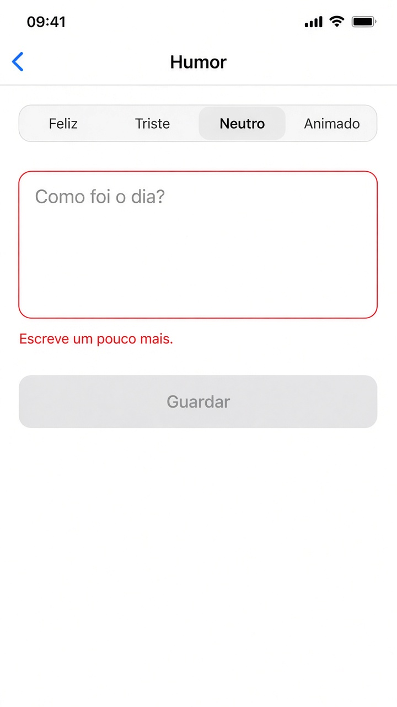

# Capítulo 6 — O que fazer

**Desenvolvimento iOS · 3º ano**

São três exercícios sobre o que a tela faz quando a pessoa toca, arrasta ou digita. Faça o seu primeiro, nos arquivos da pasta do exercício. A resolução pronta está em `Resolucoes`, na pasta do projeto, fora do app.

Tudo que muda na tela passa por `@State`.

Em cada exercício, a parte **Componentes** diz o que usar. No `onChange` do iOS 17, use as duas variáveis: `.onChange(of: nome) { _, novo in }`. O `novo` é o valor depois da mudança.

Para tirar os espaços das pontas de um texto, use `trimmingCharacters(in: .whitespaces)`.

---

## 2. Humor do dia

Pasta: `2 - Humor do dia`

Exemplo de layout. A frase dentro do campo é o placeholder. Ela muda com o humor. A borda vermelha da foto é o estado de texto curto. Campo vazio fica com borda cinza e sem aviso.

Um seletor com quatro humores: feliz, triste, neutro e animado. E um campo para a observação.

Quando o humor muda, o `onChange` troca o texto de apoio do campo:

- triste: “Quer conversar sobre isso?”
- feliz: “Que bom! Conte mais...”
- animado: “O que te animou?”
- neutro: “Como foi o dia?”

A observação também passa pelo `onChange`:

- vazia: borda cinza e sem aviso
- menos de 8 caracteres: borda vermelha e um aviso pedindo para escrever mais
- 8 ou mais: borda verde

O botão **Guardar** fica desabilitado enquanto a observação não for válida.

**Componentes**

- `@State` do humor, começando em `"Neutro"`. Também `@State` da observação, do texto de apoio e do aviso. O humor é um texto.
- `Picker` com quatro linhas escritas na mão: `Text("Feliz").tag("Feliz")`, e o mesmo para Triste, Neutro e Animado. Depois, `.pickerStyle(.segmented)`.
- `.onChange(of: humor) { _, novo in }` troca o texto de apoio com `if` e `else if`, comparando `novo` com `"Triste"`, `"Feliz"` e `"Animado"`.
- `TextField(apoio, text: $observacao, axis: .vertical)`. O primeiro texto é o placeholder, por isso ele muda junto com o humor.
- `.textFieldStyle(.roundedBorder)` e `.overlay` com `RoundedRectangle().stroke` na cor da borda.
- `.onChange(of: observacao)` atualiza o aviso e a cor.
- `Text` do aviso, só quando a string não está vazia.
- `Button("Guardar")` com `.disabled` enquanto a observação, sem espaços, tiver menos de 8 caracteres.
- `.navigationTitle("Humor")`.

---
