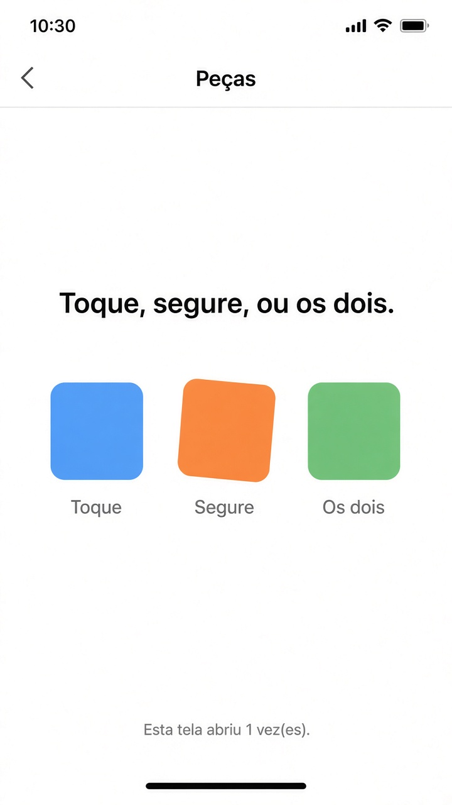

# Capítulo 6 — O que fazer

**Desenvolvimento iOS · 3º ano**

São três exercícios sobre o que a tela faz quando a pessoa toca, arrasta ou digita. Faça o seu primeiro, nos arquivos da pasta do exercício. A resolução pronta está em `Resolucoes`, na pasta do projeto, fora do app.

Tudo que muda na tela passa por `@State`.

Em cada exercício, a parte **Componentes** diz o que usar. No `onChange` do iOS 17, use as duas variáveis: `.onChange(of: nome) { _, novo in }`. O `novo` é o valor depois da mudança.

Para tirar os espaços das pontas de um texto, use `trimmingCharacters(in: .whitespaces)`.

---

## 3. Peças soltas

Pasta: `3 - Pecas soltas`

Exemplo de layout.

Três quadrados na mesma linha. Cada um é uma view separada, com `@State` próprio. Um não mexe no outro.

- o primeiro muda para uma cor aleatória no toque, com `withAnimation`
- o segundo gira 45 graus na pressão longa, com `withAnimation`
- o terceiro faz os dois: toque muda a cor, pressão longa alterna o tamanho entre 1 e 1,3, os dois com `withAnimation`

A tela conta quantas vezes apareceu, com `onAppear`. Esse número fica visível.

**Componentes**

- Três structs. Cada uma tem o próprio `@State`. A tela de cima não guarda cor nem ângulo delas.
- O primeiro: `RoundedRectangle`, `.onTapGesture` e `withAnimation` trocando a cor com `Color` e `.random(in: 0...1)`.
- O segundo: `@State` do ângulo, `.rotationEffect` e `.onLongPressGesture`. Cada pressão soma `.degrees(45)`.
- O terceiro: `@State` da cor e da escala. `.onTapGesture` muda a cor. `.onLongPressGesture` alterna a escala entre 1 e 1,3. Os dois usam `withAnimation`. `.scaleEffect` aplica o tamanho.
- Na tela, um `HStack` coloca os três quadrados lado a lado.
- `@State` do contador de aberturas, um `Text` com esse número e `.onAppear { aberturas += 1 }` na tela, não no quadrado.
- `.navigationTitle("Peças")`.
