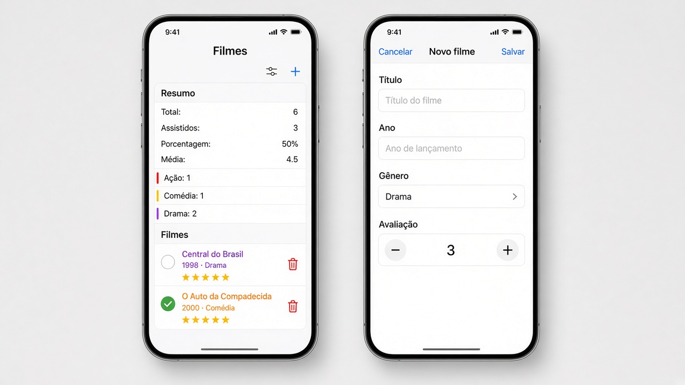
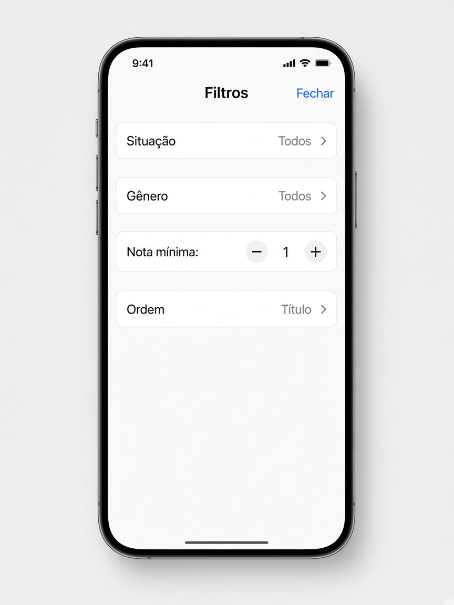

# Capítulo 7 — O que fazer

**Desenvolvimento iOS · 3º ano**

São três exercícios sobre listas. Faça o seu primeiro, nos arquivos da pasta do exercício. A resolução pronta está em `Resolucoes`, na pasta do projeto, fora do app.

A linha do `ForEach` é uma cópia. Para mudar ou apagar um item de verdade, ache ele pelo `id` na lista original.

Em cada exercício, a parte **Componentes** diz o que usar. Para tirar os espaços das pontas de um texto, use `trimmingCharacters(in: .whitespaces)`.

---

## 1. Coleção de filmes

Pasta: `1 - Colecao de filmes`

Exemplo de layout da lista. O **+** e o filtro ficam na barra de cima.

A sheet de filtros abre pelo botão da esquerda.

### O filme

Uma struct com:

- um `id` único
- título
- ano
- gênero
- nota de 1 a 5
- se já foi assistido ou não

A struct precisa funcionar dentro de uma `List`. Crie pelo menos cinco filmes de exemplo.

O gênero é um texto: `"Ação"`, `"Comédia"`, `"Drama"`, `"Animação"` ou `"Documentário"`. A cor de cada um sai de uma função com `if`.

**Componentes**

- `struct Filme: Identifiable`. O `id` é `UUID()`. O gênero é `String`.
- `func corDoGenero(_ nome: String) -> Color`. Um `if` para cada nome, devolvendo uma `Color`. Se não achar, devolva `.gray`.

### A lista

Mostre, em cada linha, o título, o ano, o gênero e as estrelas da nota. Dê um título de navegação para a tela.

- um toque marca ou desmarca “assistido”
- um botão na linha apaga o filme
- arrastar a linha também apaga

**Componentes**

- `@State` da lista de filmes, mais um Bool da sheet nova, um Bool da sheet de filtros, e um `@State` de texto para cada filtro. Situação começa em `"Todos"`, gênero em `"Todos"` e ordem em `"Título"`.
- `NavigationStack` e `List`.
- `Section` **Resumo** e `Section` **Filmes**.
- `ForEach` dos filmes visíveis, não do array inteiro.
- A linha pode ser uma view `FilmeCell`: título, ano, gênero na cor de `corDoGenero`, e as estrelas.
- As estrelas são um `ForEach(1...5, id: \.self)` de `Image(systemName:)`. Estrela pintada até a nota, estrela vazia depois.
- Um `Button` na linha alterna assistido. Outro `Button` apaga. Os dois chamam funções que procuram o `id`.
- `.onDelete` também apaga pelo `id` do filme visível naquela linha. Guarde os ids antes de remover, porque a lista encolhe no meio do laço.
- `firstIndex(where: { $0.id == filme.id })` acha o filme de verdade para marcar assistido.
- `removeAll { $0.id == filme.id }` apaga.
- `.navigationTitle("Filmes")`.
- `toolbar` com dois `Button`: o da esquerda usa `Image(systemName: "line.3.horizontal.decrease.circle")` e abre os filtros. O da direita usa `Image(systemName: "plus")` e abre o filme novo.
- Duas `.sheet(isPresented:)`.

### Incluir

Um botão **+** na barra abre uma sheet.

O formulário tem título, ano, gênero e nota. O gênero sai de um `Picker` com os cinco nomes escritos na mão. A nota pode ser um stepper de 1 a 5.

**Salvar** fica desabilitado se o título, sem espaços nas pontas, estiver vazio, ou se o ano for futuro.

**Componentes da sheet `NovoFilmeView`**

- Ela recebe o ano limite e uma closure `aoSalvar: (Filme) -> Void`. Quem acrescenta o filme na lista é a tela de baixo.

- `@State` do título, do ano em texto, do gênero e da nota.
- `NavigationStack` com título **Novo filme**.
- `Form` com `TextField` do título, `TextField` do ano (`.keyboardType(.numberPad)`), `Picker` do gênero e `Stepper` de 1 a 5.
- O `Picker` do gênero tem uma linha para cada nome: `Text("Drama").tag("Drama")`, e o mesmo para os outros quatro. O gênero escolhido é um `String`.
- `toolbar`: **Cancelar** em `.cancellationAction` e **Salvar** em `.confirmationAction`.
- `.disabled` no **Salvar** se o título, sem espaços, estiver vazio, se o ano não for número, ou se o ano for menor que 1900 ou maior que o ano atual.
- No **Salvar**, chame a closure com um `Filme` novo e depois `dismiss()`.

### Filtros e ordem

Um botão na barra abre os filtros:

- todos, só assistidos ou só não assistidos
- gênero, com uma opção “todos”
- nota mínima
- ordem por título, por ano ou por nota

Se a lista estiver filtrada, apagar pelo índice da tela remove o filme errado. Apague pelo `id` na lista original.

**Componentes da sheet `FiltrosFilmeView`**

- Quatro `@Binding`: situação, gênero, nota mínima e ordem. Os três primeiros textos começam em `"Todos"`, `"Todos"` e a ordem em `"Título"`. `"Todos"` significa que aquele filtro não corta a lista.
- `@Environment(\.dismiss)`.
- `NavigationStack` com título **Filtros** e um `Button("Fechar")` que chama `dismiss()`.
- `Form` com três `Picker` e um `Stepper` de 1 a 5, no texto `Nota mínima: \(notaMinima)`.
- Cada `Picker` escreve as opções na mão, com `Text("Drama").tag("Drama")` e as outras do mesmo jeito.
- A lista visível é um `filter`. Se a ordem for `"Ano"`, ordene pelo ano. Se for `"Avaliação"`, pela nota. No resto, pelo título.

### Resumo

No topo da lista:

- total de filmes
- quantos foram assistidos
- a porcentagem
- a média das notas
- quantos filmes existem em cada gênero

A média usa `reduce`. A contagem de cada gênero usa `filter`.

**Componentes**

- Assistidos: `filmes.filter(\.assistido).count`.
- Porcentagem: se a lista estiver vazia, mostre 0. Senão, `assistidos * 100 / filmes.count`.
- Média: `reduce` soma as notas, e você divide pelo total. Lista vazia devolve 0.
- Cada gênero é um `Text` com `filter`. Por exemplo: `filmes.filter { $0.genero == "Ação" }.count`. A cor vem de `corDoGenero("Ação")`. Repita para os outros quatro nomes.

---
