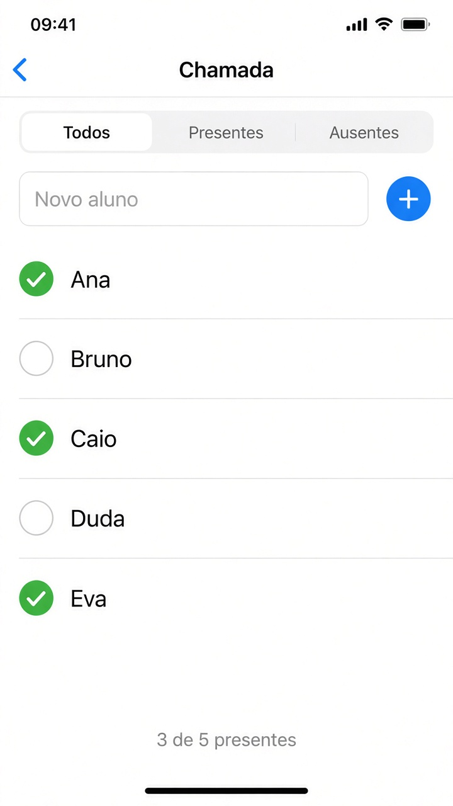

# Capítulo 7 — O que fazer

**Desenvolvimento iOS · 3º ano**

São três exercícios sobre listas. Faça o seu primeiro, nos arquivos da pasta do exercício. A resolução pronta está em `Resolucoes`, na pasta do projeto, fora do app.

A linha do `ForEach` é uma cópia. Para mudar ou apagar um item de verdade, ache ele pelo `id` na lista original.

Em cada exercício, a parte **Componentes** diz o que usar. Para tirar os espaços das pontas de um texto, use `trimmingCharacters(in: .whitespaces)`.

---

## 2. Chamada

Pasta: `2 - Chamada`

Exemplo de layout.

Uma lista de alunos. Cada um tem nome e se está presente.

- toque na linha alterna presente e ausente
- um campo adiciona aluno. Nome vazio, ou só com espaços, não entra
- arrastar apaga

Três filtros: todos, presentes e ausentes.

Com um filtro ligado, o índice que o arraste entrega é o da lista da tela, não o da lista original. Apague pelo `id`.

Embaixo, o tempo todo, o texto “X de Y presentes”.

**Componentes**

- `struct AlunoChamada: Identifiable`, com `id`, nome e presente.
- `@State` da lista, do nome novo e do filtro. O filtro é um texto e começa em `"Todos"`.
- `Picker` com três linhas: `Text("Todos").tag("Todos")`, e o mesmo para Presentes e Ausentes. Depois, `.pickerStyle(.segmented)`.
- `TextField("Novo aluno", text:)` e um `Button` com `Image(systemName: "plus")`. O botão só dá `append` se o nome, sem espaços, não estiver vazio. O aluno novo começa ausente. Depois, limpe o campo.
- Uma lista calculada, `visiveis`. Se o filtro for `"Presentes"`, use `filter` de quem está presente. Se for `"Ausentes"`, o contrário. `"Todos"` devolve a lista inteira.
- `ForEach(visiveis)`. A linha é um `Button`. O toque acha o `id` com `firstIndex(where:)` e inverte `presente`.
- Um `Image(systemName:)` mostra `checkmark.circle.fill` se estiver presente e `circle` se estiver ausente.
- `.onDelete` lê o `id` em `visiveis` e usa `removeAll`.
- O texto de baixo conta presentes na lista inteira, não só na lista filtrada: “3 de 5 presentes”.
- `.navigationTitle("Chamada")`.

---
