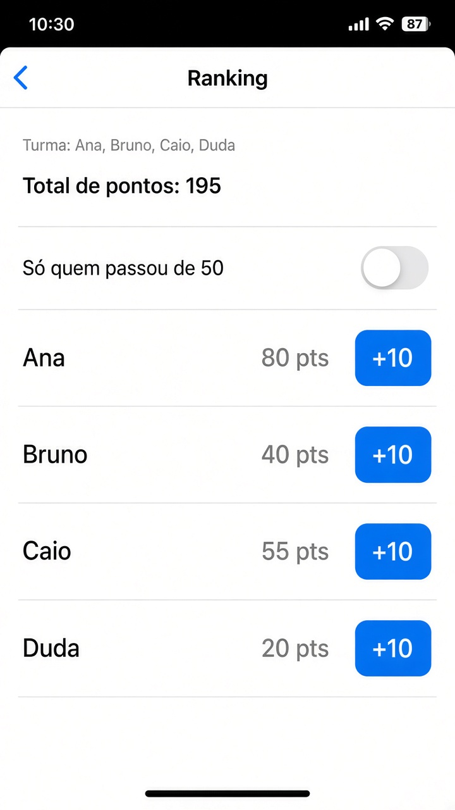

# Capítulo 7 — O que fazer

**Desenvolvimento iOS · 3º ano**

São três exercícios sobre listas. Faça o seu primeiro, nos arquivos da pasta do exercício. A resolução pronta está em `Resolucoes`, na pasta do projeto, fora do app.

A linha do `ForEach` é uma cópia. Para mudar ou apagar um item de verdade, ache ele pelo `id` na lista original.

Em cada exercício, a parte **Componentes** diz o que usar. Para tirar os espaços das pontas de um texto, use `trimmingCharacters(in: .whitespaces)`.

---

## 3. Ranking

Pasta: `3 - Ranking`

Exemplo de layout. Com o toggle ligado, some quem tem menos de 50. A frase e o total continuam com a turma inteira.

Uma lista de jogadores. Cada um tem nome e pontos.

- um botão **+10** soma naquele jogador. Ache pelo `id` antes de somar
- um toggle “Só quem passou de 50” esconde o resto, com `filter`

Em cima da lista, usando a lista inteira, não só quem está aparecendo:

- a soma de todos os pontos, com `reduce`
- os nomes numa frase só, montada com `map`

**Componentes**

- `struct JogadorRanking: Identifiable`, com nome e pontos.
- `@State` da lista e do Bool do toggle.
- `visiveis`: se o toggle estiver ligado, `filter` de quem tem mais de 50. Senão, a lista inteira.
- `reduce` soma os pontos da lista inteira.
- `map` tira só os nomes, e `joined(separator: ", ")` junta numa frase. O texto fica “Turma: Ana, Bruno, Caio, Duda”.
- `Toggle("Só quem passou de 50", isOn:)`.
- `ForEach(visiveis)` com o nome, os pontos e `Button("+10")`.
- O botão usa `firstIndex(where:)` na lista original e soma 10. Somar na cópia do `ForEach` não muda a tela.
- `.navigationTitle("Ranking")`.
