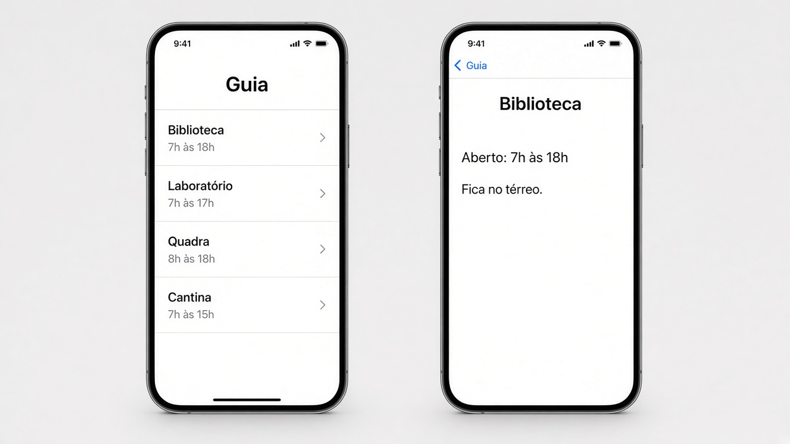

# Capítulo 8 — O que fazer

**Desenvolvimento iOS · 3º ano**

São três exercícios sobre trocar de tela. Faça o seu primeiro, nos arquivos da pasta do exercício. A resolução pronta está em `Resolucoes`, na pasta do projeto, fora do app.

`NavigationLink` só funciona dentro de um `NavigationStack`. A sheet não entra na pilha: ela sobe por cima da tela atual e fecha com `dismiss()`.

Em cada exercício, a parte **Componentes** diz o que usar. Para tirar os espaços das pontas de um texto, use `trimmingCharacters(in: .whitespaces)`.

---

## 2. Guia da escola

Pasta: `2 - Guia da escola`

Exemplo de layout.

Só pilha. Sem aba.

Uma lista com pelo menos quatro lugares da escola. Cada lugar tem nome, horário e piso.

Cada linha é um `NavigationLink`. O destino recebe aquele lugar.

No detalhe:

- o título da barra é o nome do lugar
- aparece o horário
- aparece o piso

**Componentes**

- `struct LocalEscola: Identifiable`, com nome, horário e piso.
- Uma lista fixa com pelo menos quatro lugares, dentro da view.
- `NavigationStack` e `List`.
- `ForEach` com `NavigationLink`. A linha mostra o nome e, embaixo, o horário, com `.font(.caption)`.
- O destino é `LocalDetalheView(local:)`.
- No detalhe, dois `Text`: o horário e o piso. `.navigationTitle(local.nome)`.
- `.navigationTitle("Guia")` na lista.

---
