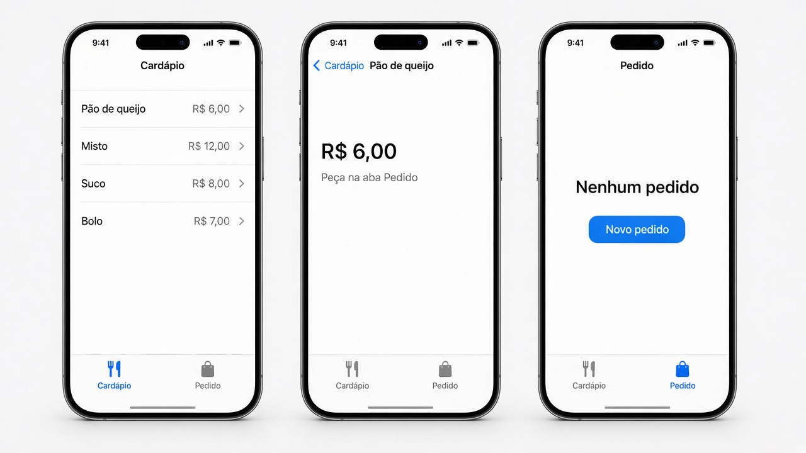
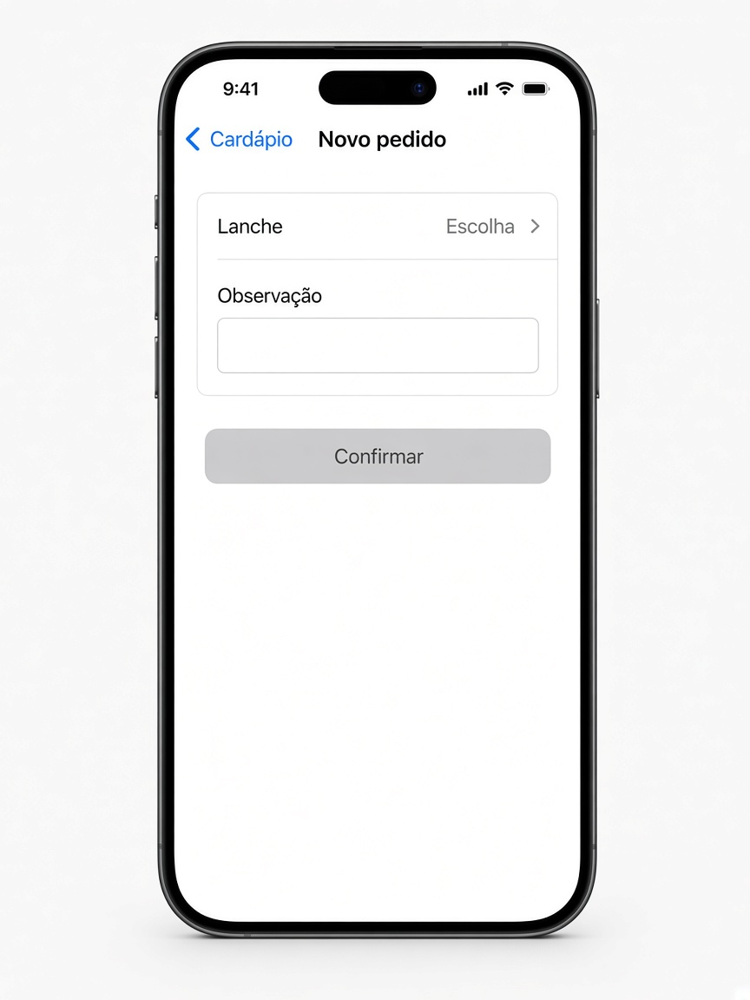

# Capítulo 8 — O que fazer

**Desenvolvimento iOS · 3º ano**

São três exercícios sobre trocar de tela. Faça o seu primeiro, nos arquivos da pasta do exercício. A resolução pronta está em `Resolucoes`, na pasta do projeto, fora do app.

`NavigationLink` só funciona dentro de um `NavigationStack`. A sheet não entra na pilha: ela sobe por cima da tela atual e fecha com `dismiss()`.

Em cada exercício, a parte **Componentes** diz o que usar. Para tirar os espaços das pontas de um texto, use `trimmingCharacters(in: .whitespaces)`.

---

## 3. Cantina

Pasta: `3 - Cantina`

Exemplo de layout.

**Novo pedido** abre esta sheet. Sem lanche escolhido, **Confirmar** fica cinza.

Depois de confirmar, a aba Pedido mostra, por exemplo, “Pão de queijo — sem gluten”.

Duas abas: **Cardápio** e **Pedido**.

O texto do pedido nasce na tela das abas. A aba Pedido lê esse texto. A sheet grava nele.

**Componentes de `CantinaView`**

- `@State` do texto do pedido, começando vazio.
- `TabView`.
- `.tabItem` com `Label("Cardápio", systemImage: "fork.knife")` e `Label("Pedido", systemImage: "bag")`.
- A aba Pedido e a sheet recebem `$pedido`. O cardápio não precisa desse texto.

### Cardápio

Um `NavigationStack` só desta aba.

Uma lista de lanches, cada um com nome e preço. O toque abre o detalhe daquele lanche. No detalhe, o título é o nome e o preço aparece na tela.

**Componentes**

- `struct Lanche: Identifiable`, com nome e preço.
- `NavigationStack`, `List` e `ForEach`.
- Cada linha é um `NavigationLink` com o nome e o preço.
- No detalhe, um `Text` do preço e `.navigationTitle(lanche.nome)`.
- `.navigationTitle("Cardápio")`.

### Pedido

Mostra o pedido feito, ou “Nenhum pedido” quando ainda não houver.

O botão **Novo pedido** abre uma sheet. Na sheet:

- um `Picker` para escolher o lanche
- um campo de observação
- **Confirmar** grava o pedido e fecha com `dismiss()`
- sem lanche escolhido, **Confirmar** fica desabilitado

Se houver observação, ela entra no texto do pedido junto com o nome do lanche.

**Componentes da aba**

- `@Binding` do texto do pedido e um `@State` Bool da sheet.
- `VStack` com um `Text` e `Button("Novo pedido")`.
- Se o texto estiver vazio, mostre “Nenhum pedido”.
- `.sheet(isPresented:)` abre o formulário com a lista de lanches e o `$pedido`.
- `.navigationTitle("Pedido")`.

**Componentes da sheet**

- `@Binding var pedido: String` e a lista de lanches.

- `@State` do lanche escolhido, um `UUID?` que começa `nil`, e `@State` da observação.
- `NavigationStack` com título **Novo pedido**.
- `Form` com `Picker("Lanche", selection:)`. A primeira opção é `Text("Escolha").tag(UUID?.none)`. Depois, `ForEach` dos lanches.
- `TextField("Observação", text:)`.
- `Button("Confirmar")` com `.disabled` enquanto nada foi escolhido.
- No toque: se a observação, sem espaços, estiver vazia, grave só o nome. Se tiver texto, grave “nome — observação”. Depois, `dismiss()`.
