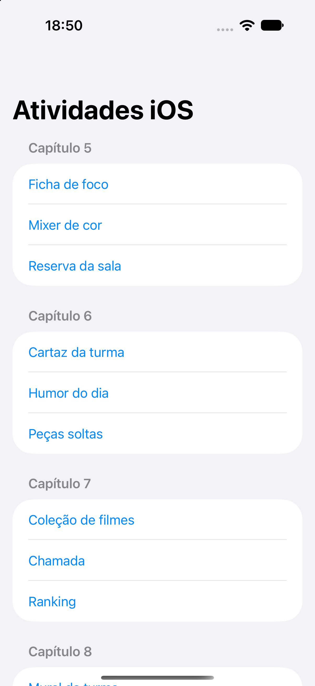

> **EN:** Fifteen independent SwiftUI exercises covering state, bindings, gestures, lists, navigation and shared ViewModels. Each exercise has its own Xcode project and GitHub repository. This repository also includes a single app with a menu for all exercises.
>
> O restante deste documento está em português brasileiro.

# Atividades iOS

Atividades dos capítulos 5, 6, 7 e 8 e da revisão: **15 projetos independentes**, com enunciados e referências de layout.

## Abrir todas no Xcode

Abra [`AtividadesIOS.xcodeproj`](./AtividadesIOS.xcodeproj), escolha o scheme **AtividadesIOS**, selecione um simulador e execute com **⌘R**. O menu organiza as atividades por capítulo.

Para executar só uma atividade, abra o `.xcodeproj` da pasta correspondente em `apps/`. Cada pasta também está publicada como um repositório individual.

Requer iOS 17 ou superior e Xcode com o SDK correspondente. Não há pacotes externos. Os dados são mantidos em memória; os exercícios não pedem persistência.

## Projetos

### 01. Ficha de foco

Ficha compartilhada entre tela principal, painel e ajustes com `ObservableObject`, `@StateObject`, `@ObservedObject`, validação e alerta ao salvar.

[Projeto local](./apps/TrilhaFoco/fichaFoco.xcodeproj) · [Código e instruções](./apps/TrilhaFoco/README.md) · [GitHub individual](https://github.com/trvzera/TrilhaFoco)

### 02. Mixer de cor

Mistura RGB com três `@State`, controles filhos com `@Binding`, trava conjunta e botão de zerar.

[Projeto local](./apps/MixerCor/MixerCor.xcodeproj) · [Código e instruções](./apps/MixerCor/README.md) · [GitHub individual](https://github.com/trvzera/MixerCor)

### 03. Reserva da sala

Formulário com nome, sala, data, pessoas e projetor; validação do nome e alerta de confirmação.

[Projeto local](./apps/ReservaSala/ReservaSala.xcodeproj) · [Código e instruções](./apps/ReservaSala/README.md) · [GitHub individual](https://github.com/trvzera/ReservaSala)

### 04. Cartaz da turma

Selo animado, figurinha com arraste, pinça e giro, validação em tempo real e contadores de publicação e fechamento.

[Projeto local](./apps/CartazTurma/cartazTurma.xcodeproj) · [Código e instruções](./apps/CartazTurma/README.md) · [GitHub individual](https://github.com/trvzera/CartazTurma)

### 05. Humor do dia

Seletor de humor com placeholder dinâmico, validação da observação e registro em memória.

[Projeto local](./apps/HumorDia/HumorDia.xcodeproj) · [Código e instruções](./apps/HumorDia/README.md) · [GitHub individual](https://github.com/trvzera/HumorDia)

### 06. Peças soltas

Três peças com estado independente, toque, pressão longa, animação e contador de aparições.

[Projeto local](./apps/PecasSoltas/PecasSoltas.xcodeproj) · [Código e instruções](./apps/PecasSoltas/README.md) · [GitHub individual](https://github.com/trvzera/PecasSoltas)

### 07. Coleção de filmes

Lista com inclusão, exclusão por ID, situação, gênero, nota mínima, ordenação e resumo da coleção inteira.

[Projeto local](./apps/ColecaoFilmes/ColecaoFilmes.xcodeproj) · [Código e instruções](./apps/ColecaoFilmes/README.md) · [GitHub individual](https://github.com/trvzera/ColecaoFilmes)

### 08. Chamada

Inclusão de alunos, presença por toque, filtros e exclusão pelo ID do item visível.

[Projeto local](./apps/Chamada/Chamada.xcodeproj) · [Código e instruções](./apps/Chamada/README.md) · [GitHub individual](https://github.com/trvzera/Chamada)

### 09. Ranking

Pontuação por jogador, filtro estritamente acima de 50 e totais com `reduce` e `map`.

[Projeto local](./apps/Ranking/Ranking.xcodeproj) · [Código e instruções](./apps/Ranking/README.md) · [GitHub individual](https://github.com/trvzera/Ranking)

### 10. Mural da turma

Abas independentes, navegação para colegas, publicação de recado, nome compartilhado, modo escuro e saída com confirmação.

[Projeto local](./apps/MuralTurma/MuralTurma.xcodeproj) · [Código e instruções](./apps/MuralTurma/README.md) · [GitHub individual](https://github.com/trvzera/MuralTurma)

### 11. Guia da escola

Lista de locais e detalhes de horário e piso, usando `NavigationStack` e `NavigationLink`.

[Projeto local](./apps/GuiaEscola/GuiaEscola.xcodeproj) · [Código e instruções](./apps/GuiaEscola/README.md) · [GitHub individual](https://github.com/trvzera/GuiaEscola)

### 12. Cantina

Cardápio com detalhes e pedido compartilhado entre abas e sheet, com lanche obrigatório e observação opcional.

[Projeto local](./apps/Cantina/Cantina.xcodeproj) · [Código e instruções](./apps/Cantina/README.md) · [GitHub individual](https://github.com/trvzera/Cantina)

### 13. Estante

Livros em um único ViewModel; inclusão, exclusão, marcação de leitura pelo ID e resumo de páginas lidas.

[Projeto local](./apps/Estante/Estante.xcodeproj) · [Código e instruções](./apps/Estante/README.md) · [GitHub individual](https://github.com/trvzera/Estante)

### 14. Laboratório

Equipes e aviso na mesma instância de ViewModel; edição de integrantes, exclusão e publicação validada.

[Projeto local](./apps/Laboratorio/Laboratorio.xcodeproj) · [Código e instruções](./apps/Laboratorio/README.md) · [GitHub individual](https://github.com/trvzera/Laboratorio)

### 15. Agenda de provas

Provas ordenadas por data, filtro de pendentes, inclusão, revisão e exclusão por ID com confirmação.

[Projeto local](./apps/AgendaProvas/AgendaProvas.xcodeproj) · [Código e instruções](./apps/AgendaProvas/README.md) · [GitHub individual](https://github.com/trvzera/AgendaProvas)

## Validação

Veja [VALIDACAO.md](./VALIDACAO.md) para resultados, ambiente e limites das verificações.

As regras dos ViewModels podem ser verificadas com `python3 scripts/testar-modelos.py`. Os testes de interface estão em [`Tests/AtividadesUITests.swift`](./Tests/AtividadesUITests.swift), vinculados ao scheme **AtividadesIOS**. Execute-os no Xcode com **⌘U**.

Os enunciados e layouts em cada atividade são o material de referência do professor. Os projetos TrilhaFoco e CartazTurma foram retomados dos repositórios existentes e completados conforme esses requisitos.

## Menu geral

