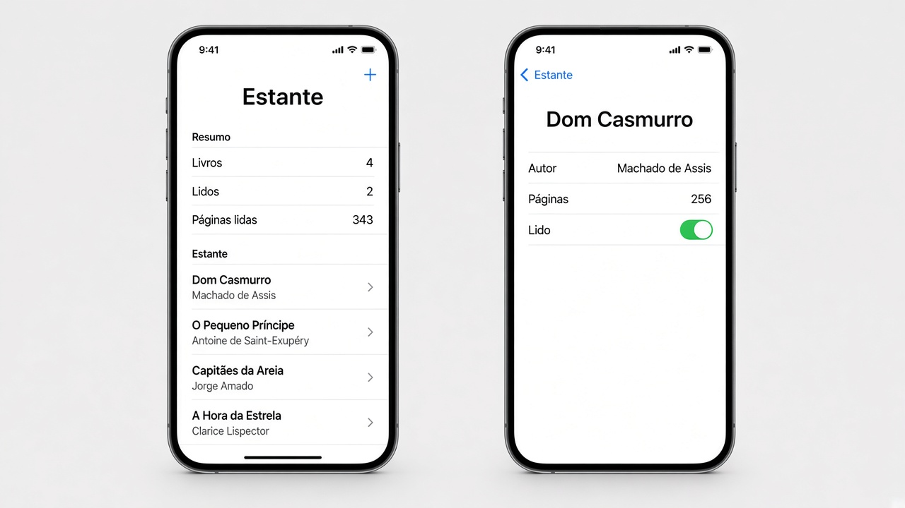
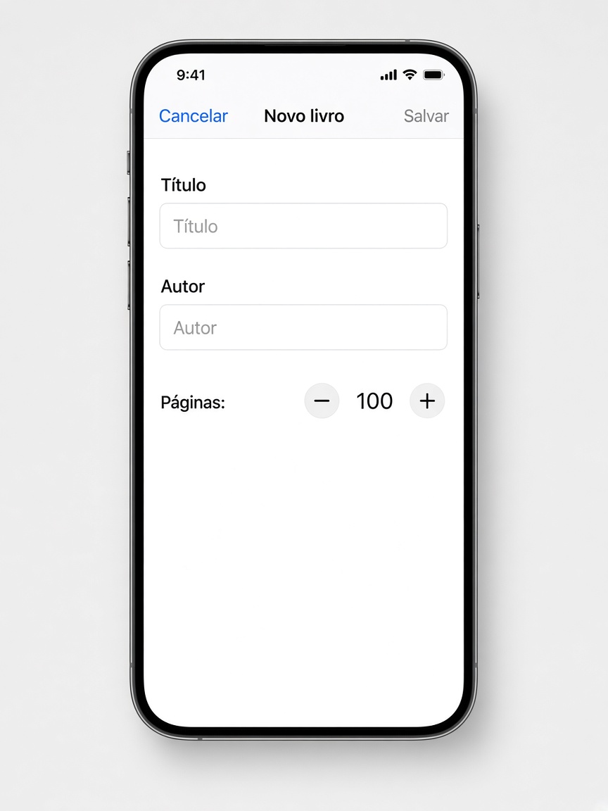

# Revisão — o que fazer

**Desenvolvimento iOS · 3º ano**

São três exercícios que misturam lista, ViewModel e navegação. Não entra gesto: sem arrastar a forma, sem pinça, sem toque longo.

Faça o seu primeiro, nos arquivos da pasta do exercício. A resolução pronta está em `Resolucoes`, na pasta do projeto, fora do app.

Em cada exercício, a parte **Componentes** diz o que usar em cada tela. O nome do componente é o que você escreve no código. O texto ao lado diz para que ele serve.

A lista mora na classe. A tela principal cria essa classe uma vez, com `@StateObject`. As outras telas recebem o mesmo objeto com `@ObservedObject`. Não crie uma segunda classe na tela filha.

Quando a tela filha precisa mudar um item, passe o `id`. Uma cópia do struct não volta para a lista.

`NavigationLink` só funciona dentro de um `NavigationStack`. A sheet sobe por cima e fecha com `dismiss()`.

Para tirar os espaços das pontas de um texto, use `trimmingCharacters(in: .whitespaces)`.

---

## 1. Estante

Pasta: `1 - Estante`

Exemplo de layout. A lista e o detalhe de um livro.

Uma pilha só. Sem aba.

No topo, um resumo: quantos livros existem, quantos estão lidos e a soma das páginas dos lidos. A soma usa `reduce`. A contagem de lidos usa `filter`.

Abaixo, a lista. Cada linha mostra o título e o autor. O toque abre o detalhe daquele livro. O arraste para o lado apaga pelo `id`.

O **+** da barra abre a sheet de livro novo. A sheet é esta:

Com título e autor vazios, **Salvar** fica cinza.

### A classe `EstanteViewModel`

Deixe pelo menos quatro livros de exemplo. Cada livro tem `id`, título, autor, páginas e se já foi lido.

A classe oferece:

- `adicionar(titulo:autor:paginas:)`
- `apagar(id:)`
- `definirLido(id:lido:)`
- uma forma de achar o livro pelo `id`

**Componentes**

- A classe adota `ObservableObject`.
- A lista fica em `@Published var livros`. Quando ela muda, a tela redesenha.
- `Livro` é `struct` e `Identifiable`. O `id` é um `UUID`.
- `filter` separa os livros com `lido` verdadeiro. O `.count` dessa lista é o número de lidos.
- `reduce` soma as páginas só dos livros lidos.
- `removeAll` apaga o livro cujo `id` é o que chegou na função.
- `firstIndex(where:)` acha a posição do livro para gravar o novo valor de `lido`.
- `first` devolve o livro daquele `id`, para o detalhe mostrar autor e páginas.

### A lista `EstanteView`

**Componentes**

- `@StateObject` cria a classe uma vez. As outras telas recebem esse mesmo objeto.
- `@State` Bool guarda se a sheet está aberta. Ele fica só nesta tela.
- `NavigationStack` em volta de tudo.
- `List` com duas `Section`: **Resumo** e **Estante**.
- `Text` nas três linhas do resumo.
- `ForEach` percorre `livros`.
- Cada linha é um `NavigationLink`. Dentro, um `VStack`: título em cima, autor embaixo, com `.font(.caption)`.
- O destino do link é `LivroDetalheView`, recebendo a classe e o `id` daquele livro.
- `.onDelete` no `ForEach`. Guarde o `id` da linha e chame `apagar(id:)`.
- `toolbar` com um `Button`. O ícone é `Image(systemName: "plus")`. O toque liga o Bool da sheet.
- `.sheet(isPresented:)` abre `NovoLivroView` e entrega a mesma classe.

### O detalhe

O título da barra é o título do livro. A tela mostra o autor, as páginas e um toggle **Lido**.

O toggle grava na classe, pelo `id`. Quando você volta, a lista e o resumo já estão atualizados.

**Componentes**

- `@ObservedObject` recebe a classe. Não use `@StateObject` aqui.
- `Form` com o conteúdo.
- `LabeledContent` para o autor e para as páginas. São textos. Não são campo editável.
- `Toggle("Lido")`. Este toggle não liga num `@State` da tela. O `Binding` lê o livro pelo `id` e grava com `definirLido(id:lido:)`.
- `.navigationTitle` com o título do livro.

### A sheet de livro novo

Campos: título, autor e um stepper de páginas, começando em 100, entre 1 e 2000.

**Salvar** fica desabilitado se o título ou o autor, sem espaços nas pontas, estiver vazio.

Ao salvar, o livro entra na classe com lido desligado, e a sheet fecha com `dismiss()`. **Cancelar** fecha sem gravar.

**Componentes**

- `@ObservedObject` da mesma classe.
- `@Environment(\.dismiss)` para fechar. A sheet não recebe o Bool que a abriu.
- `@State` para título, autor e páginas. Isso é rascunho. A classe só muda no **Salvar**.
- `NavigationStack` com título **Novo livro**.
- `Form`.
- Dois `TextField`: **Título** e **Autor**.
- `Stepper` de 1 a 2000. O texto do stepper mostra o número, no formato `Páginas: \(paginas)`.
- `toolbar` com dois `Button`: **Cancelar** em `.cancellationAction` e **Salvar** em `.confirmationAction`.
- `.disabled` no **Salvar** enquanto `podeSalvar` for falso.
- No **Salvar**, chame `adicionar` e depois `dismiss()`. No **Cancelar**, só `dismiss()`.

---
