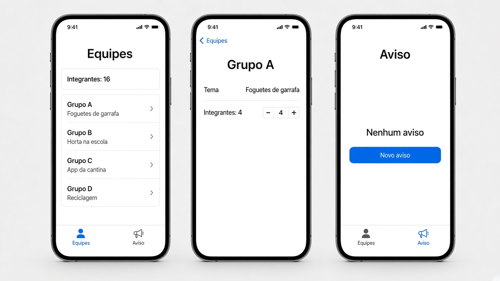
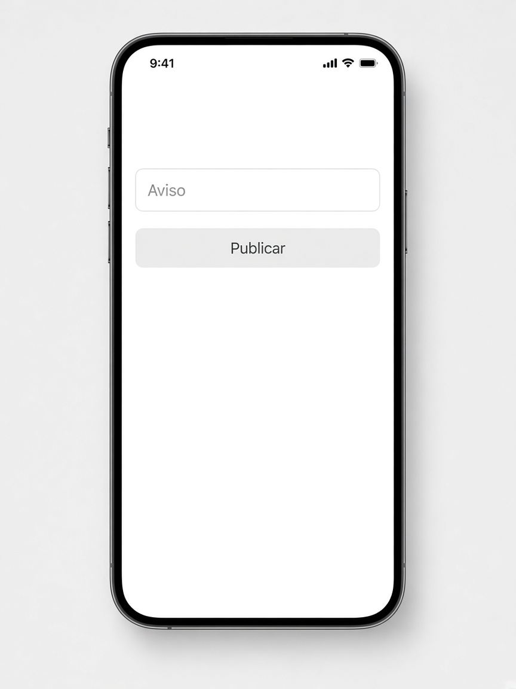

# Revisão — o que fazer

**Desenvolvimento iOS · 3º ano**

São três exercícios que misturam lista, ViewModel e navegação. Não entra gesto: sem arrastar a forma, sem pinça, sem toque longo.

Faça o seu primeiro, nos arquivos da pasta do exercício. A resolução pronta está em `Resolucoes`, na pasta do projeto, fora do app.

Em cada exercício, a parte **Componentes** diz o que usar em cada tela. O nome do componente é o que você escreve no código. O texto ao lado diz para que ele serve.

A lista mora na classe. A tela principal cria essa classe uma vez, com `@StateObject`. As outras telas recebem o mesmo objeto com `@ObservedObject`. Não crie uma segunda classe na tela filha.

Quando a tela filha precisa mudar um item, passe o `id`. Uma cópia do struct não volta para a lista.

`NavigationLink` só funciona dentro de um `NavigationStack`. A sheet sobe por cima e fecha com `dismiss()`.

Para tirar os espaços das pontas de um texto, use `trimmingCharacters(in: .whitespaces)`.

---

## 2. Laboratório

Pasta: `2 - Laboratorio`

Exemplo de layout. Na terceira tela, a aba Aviso é a que está selecionada.

A sheet do aviso novo é esta. Com o campo vazio, **Publicar** fica cinza.

Duas abas. As duas olham a mesma classe, criada na tela das abas.

- **Equipes**, ícone `person.3`
- **Aviso**, ícone `megaphone`

### A classe `LaboratorioViewModel`

Deixe pelo menos quatro equipes. Cada uma tem `id`, nome, tema e quantidade de integrantes.

Guarde também o texto do aviso, começando vazio.

`totalIntegrantes` soma os integrantes com `reduce`.

A classe apaga uma equipe pelo `id`, muda a quantidade de integrantes pelo `id` e publica o aviso.

**Componentes**

- `class` com `ObservableObject`.
- `@Published var equipes` e `@Published var aviso`.
- `EquipeLab` é `struct` e `Identifiable`, com `id` do tipo `UUID`.
- `reduce` soma `integrantes`.
- `removeAll` apaga pelo `id`.
- `firstIndex(where:)` acha a equipe para gravar o novo número de integrantes.
- `first` devolve a equipe daquele `id`.

### A tela das abas `LaboratorioView`

**Componentes**

- `@StateObject` cria a classe uma vez.
- `TabView`.
- Cada aba usa `.tabItem` com `Label`. O texto e o ícone ficam no `Label`: `Label("Equipes", systemImage: "person.3")` e `Label("Aviso", systemImage: "megaphone")`.
- As duas views filhas recebem a mesma classe.

### Aba Equipes

Dentro de um `NavigationStack`:

- título **Equipes**
- o texto “Integrantes: (total)”
- a lista. Cada linha mostra o nome e o tema
- cada linha é um `NavigationLink`
- o arraste apaga pelo `id`

No detalhe, o título da barra é o nome da equipe. Aparece o tema e um stepper de integrantes, de 1 a 12. O stepper grava na classe.

**Componentes da lista**

- `@ObservedObject` da classe. Não crie outra.
- `NavigationStack` só desta aba.
- `List` com o `Text` do total e o `ForEach` das equipes.
- Cada linha é um `NavigationLink` com um `VStack`: nome e tema.
- O destino é o detalhe, com a classe e o `id`.
- `.onDelete` chama `apagar(id:)`.
- `.navigationTitle("Equipes")`.

**Componentes do detalhe**

- `@ObservedObject` e o `id` da equipe.
- `Form`.
- `LabeledContent` para o tema. É texto, não campo.
- `Stepper` de 1 a 12. O `Binding` lê o número na classe e grava com `definirIntegrantes(id:valor:)`.
- `.navigationTitle` com o nome da equipe.

### Aba Aviso

Mostra o aviso publicado, ou “Nenhum aviso” quando ainda não houver.

O botão **Novo aviso** abre uma sheet. A sheet não recebe o Bool que a abriu.

Ela tem um campo e um botão **Publicar**.

- **Publicar** fica desabilitado se o campo, sem espaços nas pontas, estiver vazio
- ao tocar, grava o texto na classe e fecha com `dismiss()`

**Componentes da aba**

- `@ObservedObject` da classe.
- `@State` Bool da sheet, só nesta aba.
- `NavigationStack` com título **Aviso**.
- `VStack` com um `Text` e um `Button("Novo aviso")`.
- O `Text` usa o aviso da classe. Se a string estiver vazia, mostre “Nenhum aviso”.
- `.sheet(isPresented:)` abre o formulário e entrega a mesma classe.

**Componentes da sheet**

- `@ObservedObject` da classe.

- `@State` para o rascunho. A classe só muda no **Publicar**.
- `VStack` com `TextField("Aviso", text:)` e `.textFieldStyle(.roundedBorder)`.
- `Button("Publicar")` com `.disabled` enquanto o rascunho, sem espaços nas pontas, estiver vazio.
- No toque: `publicarAviso` e `dismiss()`.

---
