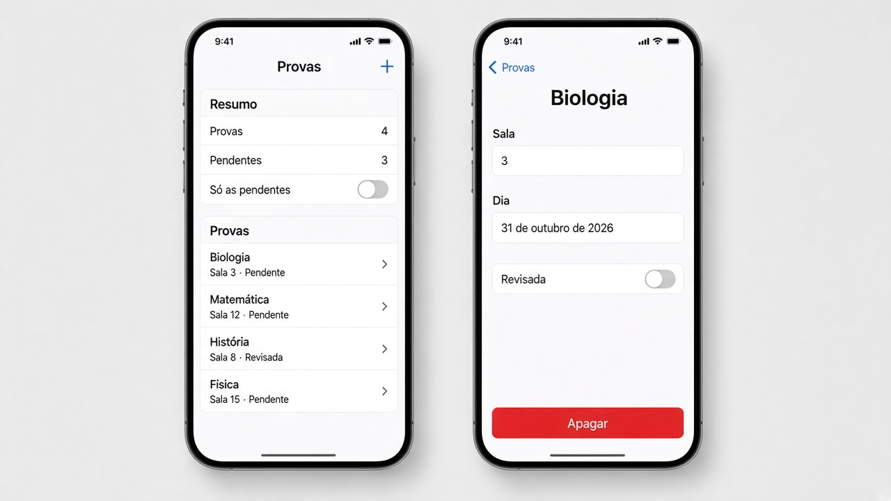
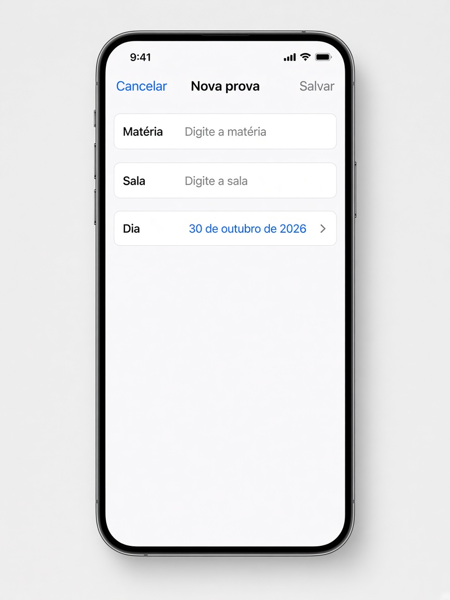

# Revisão — o que fazer

**Desenvolvimento iOS · 3º ano**

São três exercícios que misturam lista, ViewModel e navegação. Não entra gesto: sem arrastar a forma, sem pinça, sem toque longo.

Faça o seu primeiro, nos arquivos da pasta do exercício. A resolução pronta está em `Resolucoes`, na pasta do projeto, fora do app.

Em cada exercício, a parte **Componentes** diz o que usar em cada tela. O nome do componente é o que você escreve no código. O texto ao lado diz para que ele serve.

A lista mora na classe. A tela principal cria essa classe uma vez, com `@StateObject`. As outras telas recebem o mesmo objeto com `@ObservedObject`. Não crie uma segunda classe na tela filha.

Quando a tela filha precisa mudar um item, passe o `id`. Uma cópia do struct não volta para a lista.

`NavigationLink` só funciona dentro de um `NavigationStack`. A sheet sobe por cima e fecha com `dismiss()`.

Para tirar os espaços das pontas de um texto, use `trimmingCharacters(in: .whitespaces)`.

---

## 3. Agenda de provas

Pasta: `3 - Agenda de provas`

Exemplo de layout. O alerta “Apagar esta prova?” abre por cima do detalhe, com Apagar e Cancelar.

O **+** abre esta sheet. Com matéria e sala vazias, **Salvar** fica cinza.

Uma pilha. A classe guarda as provas e também o filtro.

### A classe `AgendaProvasViewModel`

Deixe pelo menos quatro provas. Cada uma tem `id`, matéria, sala, dia e se já foi revisada.

`soPendentes` começa desligado. Com ele ligado, a lista mostra só as que ainda não foram revisadas. A ordem é pelo dia, da mais próxima para a mais distante.

`pendentes` conta quantas ainda não foram revisadas.

Dá para adicionar, apagar pelo `id` e marcar revisada pelo `id`.

**Componentes**

- `class` com `ObservableObject`.
- `@Published var provas` e `@Published var soPendentes`.
- `ItemProva` é `struct` e `Identifiable`. O dia é um `Date`. O `id` é um `UUID`.
- `visiveis` é uma lista calculada. Se `soPendentes` estiver ligado, use `filter` para ficar só com `revisada == false`. Depois `sorted`, comparando `dia`.
- `pendentes` usa `filter` e `.count`.
- `removeAll` apaga pelo `id`.
- `firstIndex(where:)` acha a prova para gravar `revisada`.
- `first` devolve a prova daquele `id`.

### A lista

Título **Provas**.

No resumo: o total e quantas estão pendentes.

Um toggle **Só as pendentes**, ligado em `soPendentes`.

Cada linha mostra a matéria, a sala e “Revisada” ou “Pendente”. O toque abre o detalhe. O arraste apaga pelo `id` do item que está na tela. Com o filtro ligado, o índice da linha não é o índice do array completo.

O **+** abre a sheet de prova nova.

**Componentes**

- `@StateObject` cria a classe uma vez.
- `@State` Bool da sheet.
- `NavigationStack` e `List`.
- `Section` **Resumo**: dois `Text` e um `Toggle("Só as pendentes", isOn: $agenda.soPendentes)`. Esse toggle liga direto na propriedade da classe.
- `Section` **Provas**: `ForEach` de `visiveis`, não do array completo.
- Cada linha é um `NavigationLink` com um `VStack`: matéria, e embaixo a sala com “Revisada” ou “Pendente”.
- `.onDelete` lê o `id` em `visiveis`, naquela linha, e chama `apagar(id:)`.
- `toolbar` com `Button` e `Image(systemName: "plus")`.
- `.sheet(isPresented:)` abre `NovaProvaView` com a mesma classe.
- `.navigationTitle("Provas")`.

### O detalhe

O título da barra é a matéria. A tela mostra a sala, o dia e um toggle **Revisada**, que grava na classe.

O botão **Apagar** abre o alerta “Apagar esta prova?”. **Apagar** remove pelo `id` e volta para a lista com `dismiss()`. **Cancelar** só fecha o alerta.

**Componentes**

- `@ObservedObject`, o `id` da prova e `@Environment(\.dismiss)`.
- `@State` Bool do alerta.
- `Form`.
- `LabeledContent` para a sala.
- Outro `LabeledContent` para o dia. O texto da data usa `Text(prova.dia, format: .dateTime.day().month(.wide).year())`.
- `Toggle("Revisada")` com `Binding` que lê a prova pelo `id` e grava com `definirRevisada(id:revisada:)`.
- `Button("Apagar", role: .destructive)` liga o Bool do alerta.
- `.alert("Apagar esta prova?", isPresented:)`. Dentro, **Apagar** com `role: .destructive` chama `apagar(id:)` e `dismiss()`. **Cancelar** usa `role: .cancel` e não apaga.
- `.navigationTitle` com a matéria.

### A sheet de prova nova

Campos: matéria, sala e a data.

**Salvar** fica desabilitado se a matéria ou a sala, sem espaços nas pontas, estiver vazia.

Ao salvar, a prova entra com revisada desligada, e a sheet fecha com `dismiss()`. **Cancelar** fecha sem gravar.

**Componentes**

- `@ObservedObject` da mesma classe.

- `@State` para matéria, sala e dia. O dia começa em `Date()`, que é hoje.
- `NavigationStack` com título **Nova prova**.
- `Form` com dois `TextField`, **Matéria** e **Sala**, e um `DatePicker("Dia", selection:, displayedComponents: .date)`. O picker mostra só a data, sem a hora.
- `toolbar`: **Cancelar** em `.cancellationAction` e **Salvar** em `.confirmationAction`.
- `.disabled` no **Salvar** enquanto matéria ou sala, sem espaços nas pontas, estiver vazia.
- No **Salvar**, chame `adicionar` e depois `dismiss()`.
